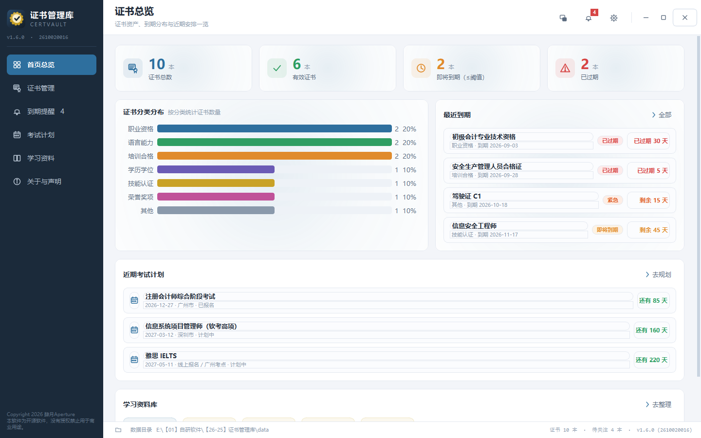

# 证书管理库 · CertVault

-2e6f9e?style=flat-square)


> **证书有效期 · 分类归档 · 考试计划 · 资料整理**  
> 100% 离线单机的 Windows 桌面工具，单文件绿色 exe，不联网、不依赖浏览器。



> 由 `tools/offscreen_check.py` 真实渲染窗口内容生成，所见即所得。

---

## 📖 这是什么

一个把「手头那一堆证书」管明白的本地工具：录入一次，之后**到期前自动提醒**，  
附件与 PDF 随手可查，分类归档、备考计划、复习资料都在同一个窗口里。

- **到期提醒**：已过期 / 紧急 / 即将到期三级分色，阈值可自定义，跨日自动刷新，支持当天免打扰。
- **PDF 预览与导出**：内置阅读器直接看证书扫描件（翻页 / 缩放 / 适应宽度），导出台账 PDF、CSV 与单张信息单。
- **分类归档**：自定义分类与配色、搜索、状态筛选，附件随库保存。
- **考试计划**：报名时间、考期、倒计时与备考资料。
- **窗口悬浮窗**：常驻桌面的速览小面板，靠边吸附、内容自选。
- **系统托盘**：最小化收进托盘，提醒不打扰，工作不中断。
- **开机自启**：可设为随 Windows 登录自动启动（设置面板里勾一下）。

---

## 🧰 界面一览

| 首页总览 | 证书管理 | 到期提醒 |
| ---- | ---- | ---- |
|      |      |      |

| 考试计划 | 学习资料 | 关于与声明 |
| ---- | ---- | ----- |
|      |      |       |

---

## ✨ 界面上的几处讲究

### 无边框窗口 +顶栏可拖

主窗口是**无边框**（`FramelessWindowHint`），最小化 / 最大化 / 关闭并入顶栏右上角。  
拖动、边缘缩放、Aero Snap 贴边分屏、`Win + 方向键`、双击标题栏最大化、标题栏右键系统菜单  
**全部保留原生行为**（靠 `WM_NCHITTEST` 命中测试交还系统实现）。

### Live2D 式「视角跟随」

鼠标移动时，**整块模块**跟着视线做分层视差（不是模块里的文字在框里滑）——  
白色卡面、描边、圆角、图标与文字是**同一个整体**在动 ±6px，徽标在整卡之上**再**走 ±6px。

| 抗抖设计   | 说明                                                                                                         |
| ------ | ---------------------------------------------------------------------------------------------------------- |
| 位移量化   | 带**死区（0.36px）+ 滞回（0.12 格）**：既不出现零附近翻档，也不会在 n.5 边界左右跳                                                       |
| 绝不为负边距 | `QLayout` 只要有一个边距为负，`getContentsMargins()` 就会**整组**退回 QStyle 默认值（Windows 上是 9），内容一帧横移 10px —— 这是实测抓到的最大跳变源 |
| 绝不出宿主  | 位移一律夹进「走位余量撑得住」的范围，顶出去会被裁掉一条边，只在某些角度出现，肉眼极难发现                                                              |
| 待机呼吸   | 鼠标停住 1.35s 后视线缓缓松开（衰减到 45%），重心交给一条 7s 正弦，整页进入「静息但活着」的状态                                                    |
| 帧率无关缓动 | `α = 1 − exp(−dt/τ)`，掉帧 / 切后台回来都不跳；实测帧间隔中位 15.94ms 稳定锁 60fps                                               |
| 可量化回归  | `tools/jitter_check.py` 用「假光标 + 假时钟」把「抖」量成数字（方向反转次数 / 单帧最大跳变 / 门槛帧），修复后慢扫 9px → **1px**、划过卡片 7px → **1px** |

### 统计卡的数字与单位

单位「本」必须**紧跟数字放同一行**。基线对齐靠 `descent(数字) − descent(单位)`  
补齐（实测基线差 **0px**、水平间距 8–9px），而不是把单位丢在横向布局最后一格——  
那会让它离数字整整一个卡片的宽度、还比标签低 7px。

---

## 6️⃣ 开机自启（v1.5.0）

设置面板 →「开机自启」卡片，勾选后随 Windows 登录自动启动。

| 项      | 说明                                                                          |
| ------ | --------------------------------------------------------------------------- |
| 实现方式   | 当前用户注册表 `HKCU\...\CurrentVersion\Run`，**不需要管理员权限**、不弹 UAC                   |
| 路径带引号  | 注册表里存的是 `"<exe 路径>"` —— 本项目路径含空格与中文，不引号会被系统截断                               |
| 随时可关   | 取消勾选即删除该项；也可以自己去 `regedit` 手工删                                              |
| 开发态不可用 | 源码运行时 `sys.executable` 是 `python.exe`，写进启动项会让系统每次开机去跑解释器 —— 此时开关**置灰**并说明原因 |

> **为什么不用「启动文件夹快捷方式」**：那要生成 `.lnk` 文件，得依赖 COM 或额外写文件；  
> 注册表项只是一行字符串，创建 / 删除 / 查证都干净可靠。

> **两个设计取舍**
>
> ① **设置面板以注册表实际状态为准**，而不是读设置项 —— 用户可能手工在注册表里删过项，  
> 或者换了机器 / 换了 exe 路径，读设置项会显示「已开启」但实际没生效。  
> ② **先改注册表、成功才落库** —— 反过来（先落库再写注册表）会留下  
> 「设置显示已开启、实际没生效」的假状态。失败时弹提示并**中止整次保存**，  
> 宁可让用户改完再点一次，也不要写进去一半。

---

## 7️⃣ 启动体验：启动动画 + 静默运行（v1.6.0）

双击 exe 之后先看到一枚居中的圆角卡片：徽标呼吸、四段阶段文案、进度条自绘走字，  
主窗口就绪后淡出退场。**全程没有任何黑色控制台窗口。**


| 项    | 说明                                                                           |
| ---- | ---------------------------------------------------------------------------- |
| 启动动画 | 300×268 无边框圆角卡片，徽标呼吸（1.8s 周期、±3.5%）、顶部金蓝渐变细线、进度条自绘走字、四段阶段文案随加载推进             |
| 淡入淡出 | 淡入 `α = 1 − exp(−dt/0.12)`（帧率无关，约 0.35s 到满），淡出 260ms                         |
| 最短展示 | 900ms —— 启动很快时也不会「一闪而过」                                                      |
| 不抢焦点 | `Qt.SplashScreen` + `WA_ShowWithoutActivating`，不进任务栏、不占 Alt-Tab              |
| 异常兜底 | 主窗口构造失败时立刻 `shutdown()` 收掉；**即使调用方忘了调 `finish()`，动画自己也会在阶段走完后自动退场**，绝不会把用户困住 |

> 效果图由 `build/_shot160.py` 真实渲染 `Splash` 控件生成，不是设计稿。

### 静默运行：黑窗的根因与解法

> **为什么双击 exe 会先闪一个黑 cmd 窗口**
>
> 本软件是 PyInstaller `--noconsole` 打出来的 **GUI 程序，本身没有控制台**。而「启动时清理  
> 残留进程」要调 `tasklist` / `taskkill`，「在文件夹中显示」要调 `explorer` —— 这些都是  
> **控制台程序**。Windows 遇到一个没有控制台的进程去创建控制台程序时，会**自动给它分配  
> 一个新控制台**，于是就弹出了那个标题栏显示 `C:\WINDOWS\SYSTEM32\task...` 的黑窗。  
> （v1.5.0 引入开机自启时把这个老毛病带了出来。）
>
> 解法是给子进程传 `creationflags`。全部子进程调用统一走 `app/procutil.py`  
> （`run_silent` / `popen_silent`），`tools/startup_check.py` 里有一条守卫专门扫  
> `app/` 下有没有漏改成裸 `subprocess` 的调用。
>
> **标志只给两个，而且不能多给**：
>
> | 标志                             | 作用           |
> | ------------------------------ | ------------ |
> | `CREATE_NO_WINDOW`（0x08000000） | 不给子进程分配控制台窗口 |
> | `SW_HIDE`                      | 双重保险         |
>
> ⚠️⚠️ **`STARTF_USESHOWWINDOW` 绝对不能加**。最初以为「三个标志一起给才彻底静默」，  
> 实测 8 种组合后发现它恰恰是元凶 —— 它与 `capture_output=True`（重定向管道）组合会让  
> `tasklist` **永久挂死**，调用方跟着一起死：
>
> | 组合                                 | `tasklist` |
> | ---------------------------------- | ---------- |
> | 无标志 /只有 `CREATE_NO_WINDOW`         | 正常         |
> | `STARTF_USESHOWWINDOW`（单独或与任何标志组合） | **挂死**     |
> | **`CREATE_NO_WINDOW｜SW_HIDE`**     | ✅ **正解**   |
>
> 这个坑的代价特别大：冻结态没有 stderr，症状只是「双击 exe 什么都不发生、  
> 进程还在但没有窗口」，不插桩写文件根本定位不到。

---

## 8️⃣ 窗口悬浮窗（v1.2.0）

一块常驻桌面的证书速览小面板。

| 能力       | 说明                                                  |
| -------- | --------------------------------------------------- |
| 开关三处联动   | 顶栏图标 / `Ctrl+Shift+F` / 设置面板，面板自己的 ✕ 也同步            |
| 常驻桌面     | 独立顶层窗口（`Qt.Tool`，不进任务栏、不占 Alt-Tab）、默认置顶、弹出不抢焦点      |
| **独立驻留** | ★ 主窗口最小化后它**仍留在桌面上**（详见下方「托盘这块最容易踩的一个坑」）            |
| 靠边吸附     | 拖动中实时预告「会吸到哪条边」，松手完全贴齐屏幕边缘，拖出屏幕自动夹回                 |
| 贴边收起     | 可选收成 8px 窄边（带把手），鼠标移入滑出、离开 0.32s 滑回                 |
| 内容自选     | 7 块——日期时钟 / 证书状态 / 最近到期 / 近期考试 / 分类分布 / 学习资料 / 今日提示 |
| 位置记忆     | 关闭前位置落库，重启回到原处，换显示器导致越界时自动回落                        |

---

## 9️⃣ 系统托盘（最小化驻留）

| 项    | 行为                                   |
| ---- | ------------------------------------ |
| 最小化  | **收进托盘**（`hide()`），任务栏里不再有它，只剩一个托盘图标 |
| 关窗口  | 默认也收进托盘，可在设置里关掉                      |
| 托盘菜单 | 显示主窗口 / 到期提醒 / 悬浮窗开关 / 立即检查 / **退出** |
| 真退出  | 只认托盘菜单的「退出」，确保不留后台进程                 |
| 驻留计数 | 托盘提示里带待关注数量（`证书管理库 v1.4.2 · 4 本待关注`） |

设置面板（系统托盘卡片）里三个开关：最小化收托盘 / 关闭窗口收托盘 / 收进托盘后气泡通知。

> **托盘这块最容易踩的一个坑**
>
> 「最小化后悬浮窗还在」这件事，表面看是 `isVisible()` 返回 `True` 就够了——  
> &#x4F46;**`QWidget.isVisible()` 只反映 Qt 的逻辑标志，不代表 Windows 上真的可见**。  
> 原实现 `FloatWindow(self.db, self)` 传了 parent，Qt 会把悬浮窗挂成主窗口的  
> transient child → Windows 层面它就是个 **owned window**（`GetWindow(hwnd, GW_OWNER)`  
> 能查到主窗口 hwnd）→ **主窗口一最小化，系统顺手把它一起藏掉**，而代码里看「还可见」。
>
> 改为 `parent=None` 后实测：`GW_OWNER = 0`、`IsWindowVisible = True`，稳稳留在桌面上。  
> 同理，最小化必须 `hide()` 而不是 `showMinimized()`（后者只是把任务栏按钮换成最小化态，  
> 窗口**还在任务栏上**，跟「收起来」正好相反）。

---

## 🔟 运行与安全

| 项       | 说明                                                                                         |
| ------- | ------------------------------------------------------------------------------------------ |
| 离线单机    | 100% 不联网，所有数据只保存在本机数据目录                                                                    |
| 单文件 exe | PyInstaller `--onefile --noconsole`，绿色免安装，双击即用                                             |
| 启动清理    | exe 态启动会先结束同名残留进程（开发态绝不清理，避免误杀用户其它 Python 程序）。★ **onefile 有两个同名进程，清理时必须跳过自己的整条祖先链**，详见下方说明 |
| 退出即释放   | 从托盘菜单「退出」时走 `os._exit(0)`，确保不留后台进程                                                         |
| 数据目录    | 首次运行自动创建，路径在底部信息条里（可点击直接打开）                                                                |
| 数据备份    | 改动前自动备份数据库到 `data/backups/`                                                                |

> ### ⚠️⚠️ 这里修掉一个「双击 exe 什么都没发生」的真 bug
>
> **症状**：双击 exe 之后进程起来了（任务管理器里能看到），但**永远不显示窗口**，  
> 也没有任何报错。
>
> **根因**：PyInstaller **onefile** 模式下，同一个 exe 会有**两个同名进程** ——  
> `bootloader`（父，负责解包并拉起子进程）和真正的应用（子，跑 Python 代码）。  
> 两者的 `IMAGENAME` 完全相同，所以 `tasklist /FI "IMAGENAME eq 证书管理库.exe"`  
> **两个都匹配**。
>
> 原来的清理逻辑只排除了 `os.getpid()`（也就是应用自己），于是把 **bootloader  
> 父进程也 `taskkill /F` 掉了**。父进程一死，onefile 子进程失去依附被挂起 ——  
> 程序就永远停在启动中。
>
> **修法**：排除「自己 + 自己的整条祖先链」。新增 `singleton._ancestor_pids()`，  
> 用 `CreateToolhelp32Snapshot` 读 `th32ParentProcessID` 一路向上收集（最多 16 层，  
> 防环），清理时跳过整个集合。
>
> ```python
> protected = _ancestor_pids() | {os.getpid()}
> ...
> if pid in protected:
>     continue          # ★ 不再用 `pid == me` —— onefile 下会漏掉 bootloader
> ```
>
> `tools/startup_check.py` 第 ⑨ 组就是这条的守卫：断言「直接父进程在祖先集合里」  
> 且「源码里不再出现 `if pid == me:`」。

---

## 🔢 版本命名与迭代记录

### 命名规则

| 组成   | 规则                                             | 示例                    |
| ---- | ---------------------------------------------- | --------------------- |
| 版本号  | `vMAJOR.MINOR.PATCH`，**第二位为大版本迭代位，第三位为小版本迭代位** | `v1.6.0`              |
| 构建号  | 10 位：`YYMMDD` + 当日 4 位迭代序号                     | `2610020016`          |
| 完整标识 | `vX.Y.Z (构建号)`                                 | `v1.6.0 (2610020016)` |

- **大版本迭代（第二位 +1）**：新增模块、数据库结构变更、UI 整体改版 → `v1.3.x` → `v1.4.0`
- **小版本迭代（第三位 +1）**：功能细节打磨、缺陷修复、文案与视觉微调 → `v1.4.1`、`v1.4.2` …

### 迭代节奏

1. 改代码 → 2. 升版本号 → 3. 跑九套回归 → 4. 更新 README 迭代表与 CHANGELOG →
2. 打包 → 6. 新 exe 放根目录、旧 exe 移到 `history/`


### 迭代记录

| 版本 | 构建号 | 日期 | 类型 | 主要变更 |
| -- | --- | --- | -- | ---- |
| **v1.6.0** | 2610020016 | 2026-10-02 | 大版本 · 体验优化 | **新增启动动画 + 全程静默运行**。① **黑窗的根因**：本程序是 PyInstaller `--noconsole` 的 GUI 程序、本身没有控制台，而「启动清理残留进程」要调 `tasklist` / `taskkill`、「在文件夹中显示」要调 `explorer` —— 这些都是**控制台程序**，Windows 遇到没有控制台的进程去创建它们时会**自动分配一个新控制台**，于是双击 exe 先闪一个标题栏为 `C:\WINDOWS\SYSTEM32\task...` 的黑窗（v1.5.0 引入开机自启时把这个老毛病带出来了）。解法是给子进程传 `creationflags`，正解只有 `CREATE_NO_WINDOW`(0x08000000) **和** `SW_HIDE` 两个。⚠️⚠️ **`STARTF_USESHOWWINDOW` 绝对不能加** —— 最初以为「三个标志缺一不可才彻底静默」，实测 8 种组合后发现它恰恰是元凶：与 `capture_output=True` 组合会让 `tasklist` **永久挂死**、调用方跟着一起死（无标志 ✅ / 只有 `CREATE_NO_WINDOW` ✅ / 凡含 `STARTF_USESHOWWINDOW` ❌ / `CREATE_NO_WINDOW｜SW_HIDE` ✅）。这个坑在冻结态的症状只是「双击 exe 什么都不发生」，因为没有 stderr，**不插桩写文件根本定位不到**。新增 `app/procutil.py` 统一封装 `run_silent` / `popen_silent`，`singleton.py` 与 `dialogs.py` 的全部子进程调用改走它。② **启动动画**（`app/splash.py`）：300×268 无边框圆角卡片，徽标呼吸（1.8s 周期、±3.5%）、顶部金蓝渐变细线、**自绘**进度条（Win11 原生外观不吃圆角）、四段阶段文案随加载推进；淡入用帧率无关的 `α = 1 − exp(−dt/0.12)`，淡出 260ms，**最短展示 900ms**（启动快时也不会一闪而过）；`Qt.SplashScreen` + `WA_ShowWithoutActivating`，不进任务栏、不抢焦点。③ **动画不会把用户困住**：`main.py` 在建库前就放出动画，数据库与主窗口两条异常路径都 `shutdown()` 立刻收掉；即便调用方忘了调 `finish()`，动画自身也会在阶段走完后自动退场。新增 `tools/startup_check.py`（**42 项**），其中一条守卫专门扫 `app/` 下有没有漏改的裸 `subprocess`。⚠️ 探针真抓出三个 bug：`__init__` 漏了 `resize()` 导致实际是 640×480 的空白大方框；`finish()` 引用了不存在的 `_closing` 字段（一调必崩）；**每帧 `QElapsedTimer.restart()` 会把计时器归零**，所以拿 `elapsed()` 跟最短展示时间比较永远不成立 ⇒ 自动退场兜底形同虚设（改为自行累加展示时长）。 | ★★★ **顺带修掉一个更严重的老 bug：exe 双击后永远不显示窗口** —— onefile 模式下同一个 exe 有**两个同名进程**（bootloader 父 + 应用子），`tasklist` 两个都匹配，而原清理逻辑只排除 `os.getpid()`（应用自己），**把 bootloader 父进程也 `taskkill /F` 掉了**；父进程一死，子进程失去依附被挂起，程序永远停在启动中且无任何报错（从 v1.1.1 就存在）。新增 `singleton._ancestor_pids()`（`CreateToolhelp32Snapshot` 读 `th32ParentProcessID` 一路向上收集），清理时跳过「自己 + 整条祖先链」，`startup_check` 第 ⑨ 组（8 项）专门守这条。 |
| **v1.5.0** | 2610020015 | 2026-10-02 | 大版本 · 新功能 | **新增「开机自启」开关**。设置面板新增「开机自启」卡片，勾选后随 Windows 登录自动启动。① **走当前用户注册表** `HKCU\Software\Microsoft\Windows\CurrentVersion\Run` —— 写 `HKLM` 要管理员权限并弹 UAC，而 `HKCU` 任何用户都能写、同样在登录时启动，是这个场景下的正确选择（免提权、免安装、可随时手工删除）。没用「启动文件夹快捷方式」是因为那要生成 `.lnk`、得依赖 COM 或额外写文件，注册表项只是一行字符串。② **启动命令必须带引号** `"<exe 路径>"` —— 本项目路径含空格与中文（`E:\【01】自研软件\…`），不引号会被系统截断。③ **开发态明确拒绝**：源码运行时 `sys.executable` 是 `python.exe`，写进启动项会让系统每次开机去跑解释器，所以开发态下 `is_supported()` 为 False、复选框**置灰禁用**并显示原因，`enable()` 抛 `AutostartUnavailable` 而不是默默写个坏启动项。④ **以注册表实际状态为准**：设置面板读的是注册表而不是设置项 —— 用户可能手工在注册表里删过项，或换了机器 / 换了 exe 路径。⑤ **先改注册表、成功才落库**：反过来会留下「设置显示已开启、实际没生效」的假状态；失败时弹提示并**中止保存**，其他设置也不落库。⑥ **启动时自愈**：`main.py` 启动调一次 `sync(get_setting("autostart"))` —— 设置开着但注册表没有就补上，反之删掉（用户先用 exe 开启、后来改成源码运行时，注册表里那个指向旧 exe 的项就是僵尸启动项，必须清掉）。⑦ 自检新增「开机自启」一项（**只读注册表**，自检可能被人反复跑甚至在别人机器上跑，写了就是擅自改用户启动项），自检由 6 项变 7 项。新增 `app/autostart.py` 与 `tools/autostart_check.py`（**27 项**）。 |
| **v1.4.2** | 2610020014 | 2026-10-02 | 小版本 · 缺陷修复 + 配色 | **修掉「logo 没有显示完全」+ 哔哩哔哩换成品牌蓝**。① **图形四周被裁掉一截**：根因是 `drawImage` 用错了重载——**`drawImage(QPointF, img)` 是按 1:1 逻辑像素绘制**（实测：在 dpr=2 的 38px 画布上 `fillRect(0,0,19,19)` 会铺满整张），而遮罩是按 `box_w × dpr`（约 27~34px）造的高分辨率图，用 QPointF 画等于把一张比画布大 42% 的图按原尺寸塞进去 ⇒ 四周必然被裁；正解是改用 **`drawImage(QRectF, ...)` 显式指定目标矩形**让 Qt 自己缩放（同一张测试图用 QPointF 画红条实测 760 像素、正好大一倍，用 QRectF 画则 380/1064 与期望完全吻合）。② **哔哩哔哩改用官方品牌蓝 `#00aeec`**（此前是辅助粉 `#fb7299`），徽标底色 / 图标填充 / 淡底三处同步。③ 三个图标占画布比例从 0.70/0.72/0.78 放大回 0.86/0.88/0.90（之前为躲裁切被迫收小）。`brand_check` 新增两条守卫（「图形不得触及画布边缘」「重心必须在中央 ±40% 内」）并**双向验证**过：改回错误重载三个图标全部报错、退出码 1，改回正确版退出码 0。 |
| **v1.4.1** | 2610020013 | 2026-10-02 | 小版本 · 视觉替换 | **「联系作者」的三个平台图标换成官方真实标识**。此前是手绘简化标记（圆脸猫 / 电视机 / 眼睛），19px 下辨识度不如官方轮廓。⚠️ 但**官方素材不能直接贴图** —— 实测三张都是 **RGB 恒为 255 的白色剪影**，透明背景下预览为空白，贴浅色卡面等于隐形（这正是 v1.2.1 弃用它们改手绘的原因）。本轮采用**遮罩法**：`tools/bake_brand.py` 只取素材 alpha 通道烘焙成 8 位灰度 PNG，内嵌进 `app/brand_masks.py`（三个共约 8.7KB base64），运行时由 `icons._draw_brand()` 按品牌色填充 —— 轮廓是官方的、颜色仍随主题换，且不必往单文件 exe 里塞图片资源。**PySide6 两个坑**：① `convertToFormat(Grayscale8)` 取的是 **RGB 亮度**而不是 alpha，官方素材 RGB 恒 255 ⇒ 遮罩全白；② `setAlphaChannel()` 与 `CompositionMode_SourceIn` 对 `Format_Grayscale8` 源**都不生效**（实测挂完仍 100% 不透明）—— 最终改为 `constScanLine` 读灰度当 alpha、`setPixel` 逐点构造。 |
| **v1.4.0** | 2610020012 | 2026-10-02 | 大版本 · 新模块 | **新增「系统托盘」，悬浮窗脱离主窗口独立驻留**。① **最小化 = 收进托盘**：顶栏「最小化」不再把窗口缩回任务栏，而是 `hide()` 到系统托盘；单击图标恢复窗口，右键出菜单（显示主窗口 / 到期提醒 / 悬浮窗开关 / 立即检查 / 退出），「退出」是唯一的真退出路径。② **关窗口 ≠ 退出**：点 × 也收进托盘（可在设置里关掉）；**关闭前必须先确认托盘真的可用**，否则会出现「点了 × 没反应、任务栏里也没有、程序还在跑却找不回来」的死局。③ **悬浮窗独立驻留**（本轮最隐蔽的一条）：原实现传了 parent 挂成 transient child → Windows owned window → 主窗口一最小化系统顺手藏掉它，而 `isVisible()` 仍返回 `True`；改为 `parent=None` 后实测 `IsWindowVisible=True`、owner 为 0。④ **设置面板新增「系统托盘」卡片**（三个开关），托盘提示带待关注数量，跨零点若人不在窗口前会补一条到期气泡。新增 `app/tray.py` 与 `tools/tray_check.py`（**28 项**）。 |
| **v1.3.0** | 2610020011 | 2026-10-02 | 大版本 · 新模块 | **「到期提醒」页 UI 重排 + 新增「提醒处置」**。① **行版式重做**：一行只留四段——状态色徽标 / 证书名 + 一行元信息 / 固定 132px 状态胶囊 / 处置 + 查看；名称与元信息改用 `ElidedLabel`（单行尾部省略而不是换行撑高行高，实测超长名下行高仍58px），同一视图里右侧按钮列逐行对齐。② **提醒处置**：延期（7/30/90/180/365 天 + 自定义日期）、忽略（7/30/90 天 + 永久）、标记已处理、恢复提醒。③ **处置在全局生效**：新增 `reminder_state` 表，而 `expiring()` 默认**排除**被压下的证书——它是启动弹窗、悬浮窗、首页概览、到期提醒页**共用**的唯一数据源，所以在一处处置，六处同时安静（老库 `CREATE TABLE IF NOT EXISTS` 自动兼容，删证书时 `ON DELETE CASCADE` 清孤儿行）。④ **四个清单视图**：需要关注 / 已延期 / 已忽略 / 全部到期。新增 `tools/dispose_check.py`（**40 项**）。 |
| **v1.2.1** | 2610020010 | 2026-10-02 | 小版本 · 视觉修复 + 联系方式 | ① **统计卡「数字与文字错位」修复**：单位「本」原先被 `AlignRight｜AlignBottom` 单独丢在横向布局最后一格——离数字有整个卡片的宽度（宽卡里数字墨迹 x=69、单位 x=375），而且底对齐让它比标签还低 7px（逐像素量自用户截图）。现并进**数字那一行**紧贴数字右侧，基线差实测 **0px**。② **「关于与声明」新增「联系作者」卡片**：GitHub / 哔哩哔哩 / 微博 / 邮箱 四行，品牌色淡底徽标 + 平台名 + 地址 + 一键复制，**整行可点**分别唤起浏览器与系统邮件客户端。③ 联系方式收敛到 `version.CONTACTS` 一份数据，页面与声明正文共用；声明编号从「三、…六、」的断档补成连续的一～五。 |
| **v1.2.0** | 2610020009 | 2026-10-02 | 大版本 · 新模块 | **新增「窗口悬浮窗」**：窄头部 + 区分块 + 版权行 + 底部动作按钮的常驻速览面板。开关三处联动、常驻桌面（不进任务栏 / 不占 Alt-Tab / 弹出不抢焦点）、靠边吸附与贴边收起、7 块内容自选、位置记忆与越界回落、底部一键跳转。⚠️ 顺带修掉两处既有缺陷：**顶栏的背景从来没生效过**（`TopBar` 是 `QWidget` 的 Python 子类，而 QWidget 子类默认不画样式表 background / border，补 `setAttribute(WA_StyledBackground, True)` 即可 —— 症状只是「灰一点」，从无边框改造那版起潜伏至今）；**卡片新建控件是 queued show**，布局会把刚 `addWidget` 进来的未显示控件当空项跳过并缓存 0 高度（表现为「刷新一次内容高度就塌成只剩标题」，刷新两次又对得上，像随机跳），刷新后显式 `show()` 即可。新增 `tools/float_check.py`。 |
| **v1.1.9** | 2610020008 | 2026-10-02 | 小版本 · 动效机制 | **动效从「模块里的文字在动」改成「整块模块在动」**。上一版把位移做在卡片**内层布局的边距**上 —— 白底 / 边框 / 圆角纹丝不动，只有文字和图标在框里滑，读起来就是「框不动、字在滑」。这一版给每张卡开出一圈**走位余量**（6×8px），并把卡面从 QSS 改为**自绘**：可视卡面 = 每边内缩「余量 + 位移」，内容边距 = 同一个位移 + 余量 + 基线 —— 两者共用同一个 `(dx, dy)`，于是白底、边框、圆角、文字、图标是**同一个整体**在平移 ±6px。宿主控件几何**分毫不动**，位移完全不经过父布局 ⇒ **零重排从「算术巧合」升级为结构保证**。余量的代价由首页布局**等量让出**，因此静止位形与上一版**逐像素一致**。 |
| **v1.1.8** | 2610020007 | 2026-10-02 | 小版本 · 缺陷修复 | **修掉首页总览「动效抖动比较厉害」**。新增常驻探针 `tools/jitter_check.py`，用「假光标 + 假时钟」把「抖」量成数字，先量后修，定位并解决**四个**抖动源：① **悬停放大位移**（划过一排卡片时每张轮流把位移幅度猛拉 85%，实测单帧跳变 **7px**）；② **`QLayout` 负边距**（只要有一个内边距为负，`getContentsMargins()` 就**整组**退回 QStyle 默认值 9，内容一帧横移 10px，实测最大 9px 跳变）；③ **入场尾部**（`easeOutBack` 的 1px 过冲回摆 + 最后 1px 拖 0.2s 的慢爬，连起来读就是「一跳一跳」）；④ **待机误判**（门槛是「单帧位移 > 2px」，而慢速拖动恰好 2px/帧 → 被当成静止，视线突然松开又被拉回，整页来回摆）。修复后探针全绿：慢扫 9px → **1px**、划过卡片 7px → **1px**。 |
| **v1.1.7** | 2610020006 | 2026-10-02 | 小版本 · 动效与流畅度 | **首页总览动效全面加强 + 帧率翻倍**。采样 30fps → **60fps**，缓动改为按真实 dt 的 `1 − exp(−dt/τ)`（帧率无关，掉帧 / 切后台都不跳）。新增**待机呼吸**、**入场编排**（9 个模块按索引错峰上浮 + 柔光脉冲）、**悬停响应**、**数据动效**（统计数字滚动到位、分类分布条形逐条长出，只在数据真变了才播）。静态帧成本 0.039ms（比动态帧便宜 150 倍以上），动态帧 7.0ms（60fps 预算 16.7ms）。 |
| **v1.1.6** | 2610020005 | 2026-10-02 | 小版本 · 体验优化 | **「视角跟随」扩展到首页总览的每个模块**：页面级视线源统一采样广播，统计卡图标徽标位移 ±10px、卡片正文 ±4px、分布图条形整图 ±5px，卡面另有随视线游走的柔光高光—— 全部只改**嵌套布局的边距**（一边加、对边减，内外之和不变），所以卡片外框一动不动、父布局绝不重排。修复空状态定位：证书管理页的空态因为 `QSplitter` 仍占着 `stretch=1` 被压在界面底部，现在一并藏掉 splitter 并自己吃满剩余空间，稳妥落在正中。 |
| **v1.1.5** | 2610020004 | 2026-10-02 | 小版本 · 缺陷修复 | 底部信息栏**并入主界面**：弃用独立 `QStatusBar`（原本横贯整个窗口宽度、压在深色侧边栏之下，像外挂的一条），改为主内容列的最后一格，侧边栏因此可以一路通到底。信息条左侧数据目录改为可点按钮（长路径中间省略），右侧保留证书统计与版本号。修复顶栏拖动窗口的判定顺序：整条顶栏（= 标题栏）的判定压过顶部缩放热区，解决「抓顶栏上沿变成缩放而不是移动」；顶栏新增 `startSystemMove()` 兜底通路。 |
| **v1.1.4** | 2610020003 | 2026-10-02 | 小版本 · 新特性 | 主窗口改为**无外框模式**：去掉系统标题栏，最小化 / 最大化·还原 / 关闭并入顶栏右上角；`WM_NCHITTEST` 命中测试交还系统，边缘缩放、拖动、Aero Snap 贴边分屏、双击最大化、标题栏右键菜单全部保留；新增 **Live2D 式「视角跟随」徽标**（5 图层视差 + 缓动跟手 + 待机呼吸）；统一 `ComboBox` / `DateEdit` / `SpinBox` 三类控件的箭头风格。 |
| **v1.1.3** | 2610020002 | 2026-10-02 | 小版本 · 缺陷修复 | 修复深色系统主题（`AppsUseLightTheme=0`）与紫红强调色（`#810068`）污染 Qt 控件导致的弹层异常：显式钉死浅色调色板并把样式表挂到 `QApplication`（顶层弹层也吃得到）；完整接管 `QCalendarWidget`，两位数日期与「周一」不再被省略成「…」；新增自绘 chevron 箭头，去掉 Win11 原生样式画在下拉框右下角、不吃圆角的深灰 L 形装饰；修掉考试计划页空态下统计卡被抻成两百多像素大色块的问题。 |
| **v1.1.2** | 2610020001 | 2026-10-02 | 小版本 · 缺陷修复 | 修复「所有图标只剩左上角一小块」的渲染缺陷（`QPixmap` 设过 `devicePixelRatio` 后重复 `scale()` 导致图标被放大 4 倍后裁切）；修复下拉框箭头被渲染成横杠；统计数字改用非等宽字体（Consolas 的 `0` 带斜杠，会被看成 `Ø`）；去掉窗口标题重复追加的软件名。 |
| **v1.1.1** | 2610010001 | 2026-10-01 | 首发 | 首个正式版本：证书分类归档、有效期到期三级提醒（阈值可调 + 当天免打扰 + 跨日刷新）、内置 PDF 预览与单张信息单 / 全库台账 PDF·CSV 导出、考试计划与倒计时、学习资料分类整理；单文件绿色 exe，启动清理残留进程、退出彻底释放；完整版权与免责声明。 |

---

## 📁 目录结构

```
证书管理库/
├── 证书管理库.exe               # 最新版本（固定文件名）
├── history/                     # 历史 exe 留档 + .last_build
├── app/
│   ├── version.py               # 版本号 / 版权 / 联系方式（唯一权威来源）
│   ├── paths.py                 # 数据目录解析（源码态与冻结态）
│   ├── singleton.py             # 单实例与彻底退出
│   ├── palette.py               # 显式钉死调色板（挡系统深色主题污染）
│   ├── theme.py                 # 主题常量 + QSS + 托盘 / 浮窗样式
│   ├── icons.py                 # 全部图标现场绘制（不依赖图片资源）
│   ├── brand_masks.py           # 官方品牌标识的 alpha 遮罩（由 bake_brand 烘焙）
│   ├── autostart.py            # 开机自启（HKCU 注册表 Run 项，冻结态才可用）
│   ├── procutil.py             # 子进程静默调用封装（CREATE_NO_WINDOW，杜绝黑窗）
│   ├── splash.py               # 启动动画（无边框圆角卡片 + 呼吸徽标 + 阶段文案）
│   ├── db.py                    # SQLite 数据层 + 提醒处置 API
│   ├── widgets.py               # 自绘控件 + 视角跟随动效系统
│   ├── dialogs.py               # 各类对话框（含设置面板）
│   ├── pages.py                 # 七个页面
│   ├── floatwin.py              # 窗口悬浮窗（无边框自绘圆角面板 + 靠边吸附 / 贴边收起 +
│   │                            #   7 个可自选内容块；独立顶层窗口，不随主窗口最小化）
│   ├── tray.py                  # 系统托盘（最小化收进托盘 + 右键菜单 + 到期气泡通知）
│   ├── pdfexport.py             # PDF / CSV 导出（QPdfWriter 现场绘制）
│   ├── sampledata.py            # 示例数据
│   └── main_window.py           # 主窗口（无边框 + 顶栏 + 侧边栏 + 信息条）
├── tools/
│   ├── make_icon.py             # 生成 app.ico
│   ├── offscreen_check.py       # 界面回归 + 出效果图
│   ├── diag_ui.py               # 放大局部看渲染缺陷
│   ├── anim_check.py            # 动效回归（帧成本 / 帧间隔）
│   ├── jitter_check.py          # 抖动回归（方向反转 / 单帧跳变 / 门槛帧）
│   ├── float_check.py           # 悬浮窗回归（吸附 / 收起 / 落库 / 独立驻留，11 项）
│   ├── dispose_check.py         # 提醒处置回归（落库 / 全局过滤 / 视图联动，40 项）
│   ├── tray_check.py            # 系统托盘回归（收托盘 / 不退出 / 恢复 / 独立驻留，28 项）
│   ├── brand_check.py           # 品牌标识回归（遮罩解码 / 实心度 / 不越界 / 居中）
│   ├── autostart_check.py       # 开机自启回归（开发态拒绝 / 注册表读写 / UI 接线，27 项）
│   ├── autostart_shot.py        # 裁出「开机自启」卡片效果图
│   ├── about_contact_shot.py    # 裁出「联系作者」卡片效果图
│   ├── bake_brand.py            # 从官方 PNG 烘焙 alpha 遮罩（换素材时才需要跑）
│   └── build_exe.py             # 一键打包 + 归档 + 冻结态自检
├── assets/app.ico
├── docs/shots/                  # README 效果图
└── data/                        # 运行期数据（library.db / files / exports / backups），不入库
```

---

## 🔨 开发与打包

### 环境

- Python 3.13 + PySide6 6.11.2 + PyInstaller 6.22.2（**无其他第三方依赖**）

### 常用命令

```bash
python main.py                        # 运行
python main.py --selftest report.json # 自检（7 项）

python tools/offscreen_check.py       # 1) 界面回归 + 刷新 docs/shots 效果图
python tools/anim_check.py            # 2) 动效改动后跑一遍（帧成本与帧间隔）
python tools/jitter_check.py          # 3) 动效改动后跑一遍（抖动指标，退出码 0 = 通过）
python tools/float_check.py           # 4) 悬浮窗改动后跑一遍（吸附 / 收起 / 落库 / 独立驻留）
python tools/dispose_check.py         # 5) 提醒处置改动后跑一遍（落库 / 全局过滤 / 视图联动）
python tools/tray_check.py            # 6) 托盘改动后跑一遍（收托盘 / 不退出 / 恢复 / 独立驻留）
python tools/brand_check.py           # 7) 品牌标识改动后跑一遍（遮罩解码 / 实心度 / 不越界）
python tools/autostart_check.py        # 8) 开机自启改动后跑一遍（开发态拒绝 / 注册表 / UI）
python tools/startup_check.py           # 9) 启动体验改动后跑一遍（静默标志 / 动画兜底）
python tools/build_exe.py             # 10) 打包

### 排障：启动后不显示窗口

```bash

# 查进程树（★排障必备：onefile 有两个同名进程，只看一个会误判）
powershell -c "Get-Process 证书管理库*|Select Id,ProcessName"
tasklist /FI "IMAGENAME eq 证书管理库.exe" /FO CSV /NH
```

> `Get-Process` 看到**两个** `证书管理库` 是正常的（onefile 的 bootloader + 应用）。
> 只有一个 ⇒ 子进程被 bootloader 拖累或已崩；一个都没有 ⇒ exe 没跑起来。
 + 归档旧版 + 冻结态自检
```

> ⚠️ 回归脚本**不要设 `QT_QPA_PLATFORM=offscreen`** —— 该平台插件在 Windows 下字体库为空，
> 中文会渲染成方块。正确做法是真实 windows 平台 + `WA_DontShowOnScreen`。

`tools/build_exe.py` 一条命令完成：归档旧版 → PyInstaller 打包 → 交付到根目录 →
冻结态自检 → 冻结态 GUI 冒烟。九套回归也在冻结态 exe 上同样可用，作为发布验收。

---

## 📄 版权与声明

**Copyright 2026肆月Aperture. All rights reserved.**

本软件（证书管理库 / CertVault）的源码、界面设计、图标与文档，版权均归 肆月Aperture 所有。

**本软件为开源软件，没有授权禁止用于商业用途。**
在保留本声明与版权信息完整的前提下，允许个人免费使用、学习与研究。

**免责声明**：本软件按「现状」提供，作者不对使用或无法使用本软件所造成的任何直接、间接损失
承担责任。本软件为 100% 离线单机程序，证书数据、附件与考试计划仅保存在本机数据目录，
不会上传任何服务器。证书有效期、到期天数与提醒均依据用户自行录入的日期计算，
仅作个人管理辅助，不构成任何官方认定。

---

## 📬 联系作者

| 平台 | 地址 |
| -- | -- |
| GitHub | https://github.com/zouzuo1994321 |
| 哔哩哔哩 | https://space.bilibili.com/13715 |
| 微博 | https://weibo.com/u/5189652182 |
| 邮箱 | 921103025@qq.com |